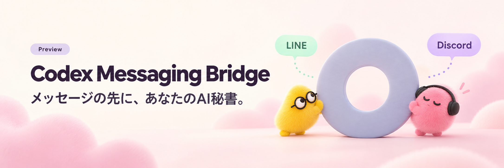

# Codex Messaging Bridge



<p align="center">
  <a href="CONTRIBUTING.md"></a>
  <a href="LICENSE"></a>
  
  
</p>

<p align="center">
  <a href="#クイックスタート-discord--個人用codex">はじめる</a> ·
  <a href="adapters/sites/README.md">クラウド版</a> ·
  <a href="docs/agent-onboarding.md">エージェントに任せる</a> ·
  <a href="#english-quickstart">English</a>
</p>

LINE・Discordから、Your dot、個人用Codex、クラウドのChatGPT WorkをAI秘書として使うためのブリッジです。OpenClawを参考にした設定・Bot導入・ペアリングを採用しています。各自のBotとアカウントを接続して使います。

An open-source LINE / Discord bridge for Your dot, personal Codex and an experimental ChatGPT Work cloud receiver.

> **公開プレビュー** — ローカルCodexとクラウド構成で実際の送受信を検証しています。クラウドの無期限常駐・停止後の即時自動復旧・応答時間の保証はありません。OpenAI・LINE・Discord・OpenClawの公式製品ではありません。

## できること

| | |
| --- | --- |
| 💬 いつもの窓口から | LINE / Discordの受信、送信者の認可、元の会話への返信 |
| 🤖 自分のAIにつなぐ | 個人用Codex、Your dot MCP Events、実験版のクラウドChatGPT Work |
| 🏡 サーバーごとに管理 | 許可チャンネルと会話履歴を分離。Sites版は同じBotで最大5サーバー |
| 📎 議事録も参照 | Sites版で公開スレッド、Bot自身の管理ロール宛メンション、ページ分割したテキスト添付を扱う |
| 🧵 続きから再開 | 再開できるセットアップ、永続受信箱、会話継続と送信の重複抑止 |

OpenClawとの対応範囲は[LINE互換仕様](docs/openclaw-parity.md)・[Discord互換仕様](docs/discord-parity.md)にまとめています。

## 構成を選ぶ

| 構成 | 返信するAI | 稼働先・必要な接続 | 導入先 |
| --- | --- | --- | --- |
| 個人用Codex | 自分のCodex CLI | 同じPCのNode Gateway。Discordは外向き接続、LINEは公開HTTPSも必要 | [クイックスタート](#クイックスタート-discord--個人用codex) |
| Your dot + MCP Events | Your dot | 到達可能なMCP接続、OAuth、イベント購読、稼働中の受信処理 | [Your dot接続](docs/dot-integration.md) |
| Sites + ChatGPT Work **実験版** | クラウドのChatGPT Work task | SitesのWorker / D1、本人用MCP接続、実行中のcloud task | [Sitesクラウド版](adapters/sites/README.md#first-party-cloud-task-receiver-experimental) |
| Discord受信箱 | CLIを操作するYour dot等 | 同じcomputerのNode Gateway。新着によるAIの自動起動なし | [受信箱の導入](docs/install.md#discord--your-dot受信箱) |

Sitesは、自分のアカウントで利用できる場合に追加のhosting契約を省く選択肢です。モデルAPIキーを作成する構成ではありませんが、ChatGPT・Sites・LINE・Discordそれぞれの利用条件と上限は適用されます。cloneだけではクラウド環境やプラグイン接続は作られません。

ChatGPT Workの返信は、Your dot本体やCodex Cloud coding taskの返信とは区別します。Work経路の会話履歴はブリッジが保存する同一会話の履歴で、Your dot本人の記憶ではありません。

## エージェントに導入を任せる

このリポジトリのURLと、次の依頼をYour dotやCodexへ渡せます。入口は[AGENTS.md](AGENTS.md)、詳しい手順は[エージェント向け導入ガイド](docs/agent-onboarding.md)です。

> AGENTS.mdに従ってLINEとDiscordを設定して。クラウド運用を希望します。Sitesが利用可能なら評価し、返信担当がYour dotかChatGPT Workかを明示して。アカウント設定は許可済みの私のPCで進め、既存の設定と承認を引き継いで。秘密はチャットやGitへ出さず、実際の送受信とローカル受信を止めた状態まで確認して。利用できない条件は未検証として残して。

Node版のクラウド準備コマンドは次のとおりです。

```bash
./bin/codex-line-bridge setup plan --target dot-cloud --channel both --mode dot
./bin/codex-line-bridge setup prepare --target dot-cloud --channel both --mode dot
```

`prepare` は `data/setup/dot-cloud/` に非公開の設定と再開状態を作ります。既存ファイルは保持し、新規プロファイルのペアリングコードは期限なしです。**これは設定の準備で、クラウド配備や常駐の完了ではありません。** Sites版の配備は[Sitesの手順](adapters/sites/README.md#agent-deployment)を使います。

## クイックスタート: Discord + 個人用Codex

Node.js **22.13以上**、npm、Git、POSIXシェル（macOS / Linux / WSL等）が必要です。Node版の外部npm実行時依存はありません。既存のインストールを更新する場合は、その非公開設定を使い続けてください。

### 1. 取得して専用設定を作る

```bash
git clone https://github.com/miyashita-code/codex-messaging-bridge.git
cd codex-messaging-bridge
npm ci --ignore-scripts
./bin/codex-line-bridge setup prepare --target local --channel discord --mode codex
```

設定は `data/setup/local/bridge.config.json`、秘密は同じ場所の `.env` に保存します。以下のコマンドはこの専用設定を指定しています。

### 2. CodexとDiscord Botを接続する

[Codex CLIの公式手順](https://learn.chatgpt.com/docs/codex/cli)で導入し、自分のアカウントにサインインします。ログイン済みなら状態を確認します。

```bash
codex login status
# 未ログインの場合
codex login
```

[DiscordのBot作成手順](docs/discord-setup.md)でApplication / Botを作り、Message Content Intentと招待権限を設定します。Bot tokenは次の端末入力で保存します。入力内容は表示されません。

```bash
./bin/codex-line-bridge --config data/setup/local/bridge.config.json channels add --channel discord --env-path data/setup/local/.env
node --env-file=data/setup/local/.env src/cli.mjs --config data/setup/local/bridge.config.json doctor --probe
node --env-file=data/setup/local/.env src/cli.mjs --config data/setup/local/bridge.config.json gateway
```

### 3. DMを承認して返信を確認する

Botへ最初のDMを送り、返ってきたコードを別の端末で承認します。`<CODE>` は実際のコードに置き換えます。

```bash
./bin/codex-line-bridge --config data/setup/local/bridge.config.json pairing list discord
./bin/codex-line-bridge --config data/setup/local/bridge.config.json pairing approve discord <CODE>
```

承認後、もう一度DMを送ります。同じDMにCodexの返信が届けば接続完了です。Gatewayの停止は `Ctrl+C`。このローカル構成はPCの電源・ネットワークが必要です。

既存Codexログインを使うapp-server認証は、ローカル・オープンソース用途向けです。商用・ホスト型サービスの共通認証として利用する構成ではありません。[公式の認証条件](https://learn.chatgpt.com/docs/app-server)

## Node版とSites版の対応範囲

| 項目 | Node Gateway | Sites adapter（実験版） |
| --- | --- | --- |
| LINE受信 | 署名検証、DM・許可グループ、メディア取得 | 承認済み本人の1対1テキスト。グループ・非テキストは対象外 |
| LINE公開受信口 | `/line/webhook`（既定、設定可能） | `/webhooks/line`（固定） |
| 初回承認 | DMペアリング、グループ許可を個別管理 | 確認済み本人IDをruntime allowlistに設定。ペアリングコードは発行しない |
| Discord受信 | Gateway / WebSocket | 許可チャンネルと本人DMのREST回収 |
| 複数Discord | アカウント・サーバー別設定 | 同一Botで主サーバー1件＋追加4件。チャンネルを明示指定 |
| 添付 | メディア取得。内容分析は接続AI・ツールに従う | 実メッセージのUTF-8 `.txt` / `.md` / `.csv` / `.json`、最大256KiB、ページ取得 |
| 履歴 | Codex会話・永続受信箱 | cloud taskへ同一会話の最大6往復 / 12メッセージ / 24,000文字を暗号化して引継ぎ |
| 常駐 | 自分の稼働ホストとサービス管理 | 実行中のcloud taskまたはcloud browser / schedule。無期限常駐は未検証 |

Sites版はDiscordの接続をGatewayで維持しないため、Botがオフライン表示でもREST経路で返信できます。招待だけでは回収対象になりません。追加サーバー・チャンネルの設定と実往復の確認が必要です。

詳しくは[LINE導入](docs/line-setup.md)、[Discord導入](docs/discord-setup.md)、[構成別インストール](docs/install.md)、[Sitesの複数サーバー設定](adapters/sites/README.md#manage-multiple-discord-servers)を参照してください。

## 実機で確認したこと

以下は2026年10月14〜15日の個別環境での結果です。利用者全員の速度・可用性を保証する値ではありません。

| 試験 | 結果 |
| --- | --- |
| ローカルCodex | LINE / Discordの実送受信、ペアリング、Gateway再起動後の承認と会話継続を確認 |
| Sites + Your dot Events | ローカル受信停止でLINE・Discordへ返信。通知後のモデル処理に数分以上かかる例もあり |
| Sites + cloud Work | ローカル受信停止・cloud taskの閲覧タブを閉じた状態で新規返信。通常のLINEは約6〜10秒、Discordは約10〜21秒の実測例 |
| LINEの遅延 | 約68〜70秒の例も発生。大半は保存前の区間で、原因は未確定 |
| 複数Discord | 追加サーバーでの実返信、既存DMの履歴保持、サーバーをまたぐ履歴分離を確認 |
| 議事録 | Bot管理ロール宛メンションへ同じ親チャンネルで返信。公開スレッド3件の読取と、別の読取工程でテキスト添付4件の末尾取得を確認 |

物理PC電源断・Wi-Fi断、24時間連続稼働、完全な無人コールドスタート、公開スレッド内の新規投稿から返信までのE2Eは未検証です。[構成と検証記録](docs/cloud-computer.md)で、現在の構成と過去の試験を分けて記載しています。

## 設定と運用

- Node版のDMは既定で `dmPolicy: "pairing"`、グループは `groupPolicy: "allowlist"`。DM承認とサーバー・グループの許可は独立しています。
- 新規 `setup prepare` のコードは期限なし。既存設定は保持します。`pairingCodeTtlMs: null` は新しく発行する承認待ちコードに適用し、承認済み接続は明示的に取り消すまで保存します。設定省略時は1時間です。
- `.env`、`bridge.config.json`、`data/`、DB・ログはGitから除外します。配布用 `*.example.json` には実際の資格情報を書きません。
- macOS LaunchAgent、Linux systemd、Caddyの例は `deploy/` にあります。バックアップ・更新時は所有するGatewayを停止し、SQLiteと関連ファイルをまとめて保存します。
- 同一Botの返信consumerは1つにします。送信結果不明・予約済みの入力は盲目的に再送せず、永続記録を確認します。

本人用の接続が前提です。ownerのMCP接続は許可済み会話を閲覧できるため、AI側にも会話をまたぐ情報共有を禁じる指示が必要です。利用者ごとのOS隔離やマルチテナントSaaSは提供しません。[セキュリティ方針](SECURITY.md)

## 開発・配布

```bash
npm ci --ignore-scripts
npm test
npm run test:sites
npm run check
npm --prefix adapters/sites run build
npm --prefix adapters/sites run validate
npm run package:cloud
```

通常のテストは実サービス認証やモデル推論を使いません。実Codex試験は明示的なopt-inです。[開発ガイド](CONTRIBUTING.md)を参照してください。

`package:cloud` は公開ソースだけの `data/codex-messaging-bridge-cloud.tar.gz` を生成します。実 `.env`、稼働中DB、本人用設定は含めません。[変更履歴](CHANGELOG.md)

GitHub Actions用の[CI設定例](deploy/github-actions-ci.yml.example)も同梱しています。Node 22.13 / 24 / 26でテスト・構文・Sitesビルド・配布物の作成を行う設定です。このリポジトリの自動CIは未有効です。有効化する場合は、workflowを書き込めるGitHub認証で `.github/workflows/ci.yml` へ配置します。

## English quickstart

Choose your reply runtime first:

- **Personal Codex:** keep the Node Gateway on your own computer. Follow the [Discord quickstart](#クイックスタート-discord--個人用codex); it creates a private profile under `data/setup/local/`. Each user signs in to their own Codex account. LINE additionally needs a public HTTPS webhook.
- **Your dot + MCP Events:** configure a reachable MCP connection, OAuth, verified subscriptions and a running receiver. See [dot integration](docs/dot-integration.md).
- **Sites + native ChatGPT Work (experimental):** the Site receives messages and a first-party cloud task generates replies through claim-based MCP tools. This is separate from Your dot itself and Codex Cloud coding tasks. See [the adapter guide](adapters/sites/README.md#first-party-cloud-task-receiver-experimental).
- **Discord inbox:** the AI reads and replies through the CLI on the same computer. This mode does not wake it automatically.

Requirements for the Node CLI: Node.js **22.13+**, npm, Git and a POSIX shell. Clone this repository, run `npm ci --ignore-scripts`, and follow [installation](docs/install.md#english-installation-guide). To delegate setup, give the agent this repository and [AGENTS.md](AGENTS.md). Preparation creates private configuration; deployment, authentication and live replies must still be verified.

The Sites path requires your own eligible Sites/ChatGPT account and connections. It uses no model API key or separate hosting contract in the tested configuration; account limits and platform availability still apply. Its LINE support is approved one-to-one text only, and its Discord profiles use one Bot across at most five servers. Node pairing commands do not configure Sites allowlists.

Real cloud replies with local receivers stopped and the local task viewer closed have passed. Physical laptop shutdown, continuous 24-hour uptime, unattended cold restart and fresh public-thread reply E2E remain unverified. Per-conversation bridge history is separate from Your dot's memory. Local app-server authentication is subject to [OpenAI's conditions](https://learn.chatgpt.com/docs/app-server) and must not be shared as authentication for a hosted service.

## License / References

[MIT](LICENSE). Independent implementation; no affiliation with OpenAI, LINE, Discord or OpenClaw. OpenClaw-style compatibility does not mean complete feature parity or official certification. Publishing this source does not publish or approve a ChatGPT plugin for other accounts.

The banner is custom AI-generated artwork inspired by the supplied visual references, not an official product illustration.

- [OpenClaw LINE](https://docs.openclaw.ai/channels/line) / [Discord](https://docs.openclaw.ai/channels/discord/setup)
- [MCP Events](https://developers.openai.com/plugins/build/mcp-events) / [Connect a ChatGPT plugin](https://developers.openai.com/plugins/deploy/connect-chatgpt)
- [Your dot computers and apps](https://learn.chatgpt.com/docs/dots/computers-and-apps) / [Long-running work](https://learn.chatgpt.com/docs/long-running-work)
- [Security reporting](SECURITY.md) / [Contributing](CONTRIBUTING.md)
